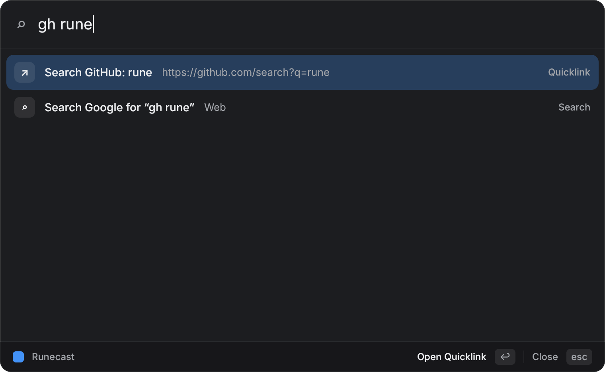
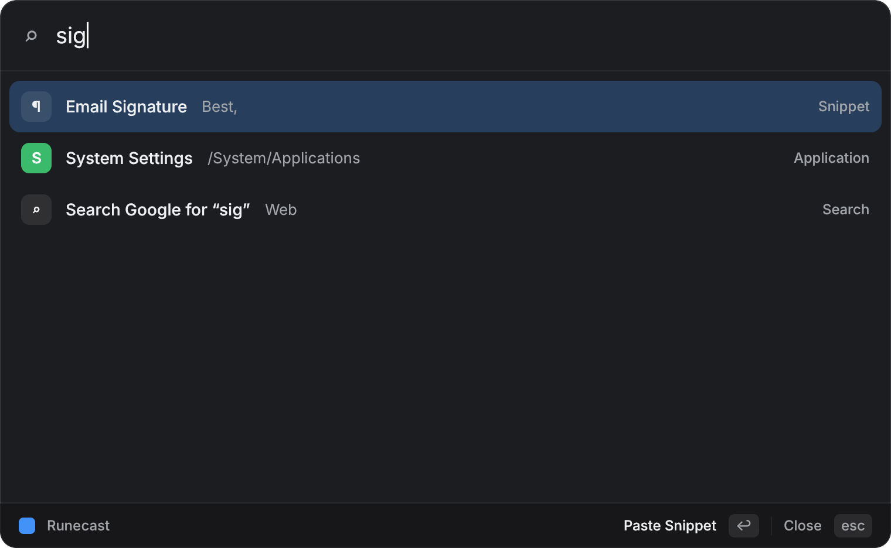
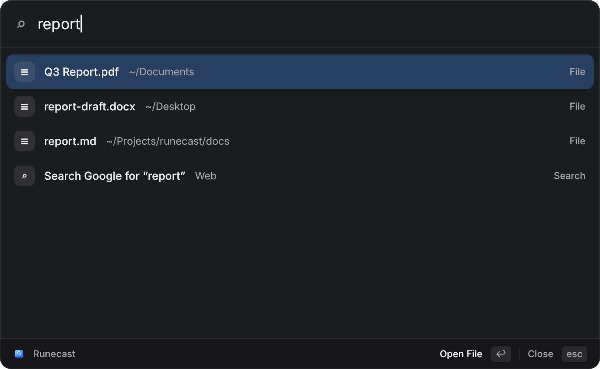
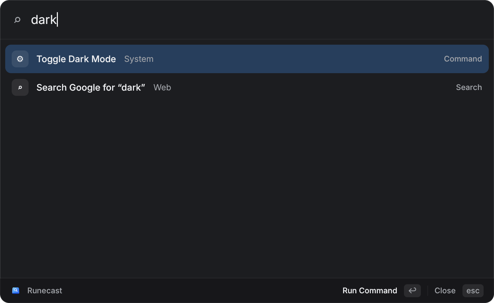
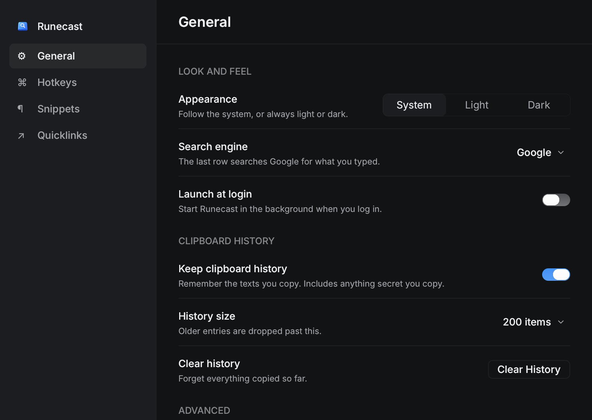
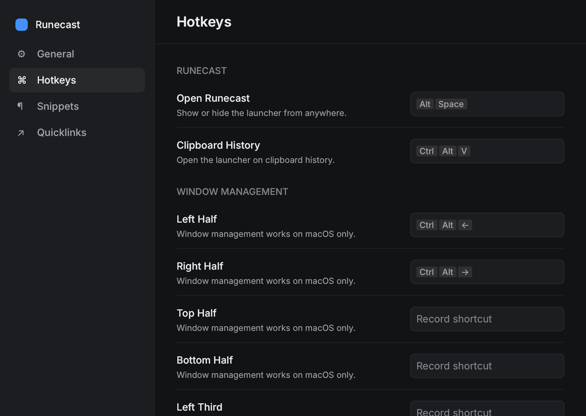
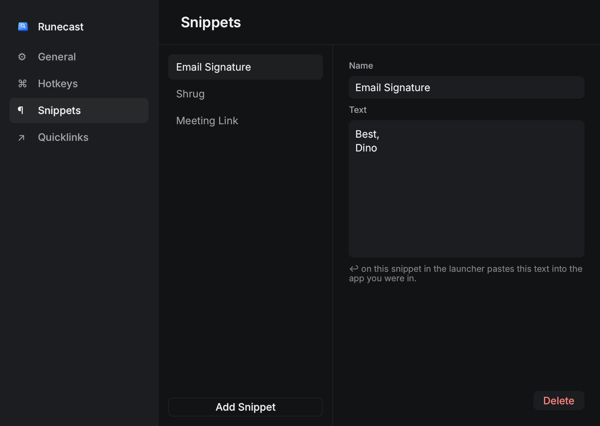
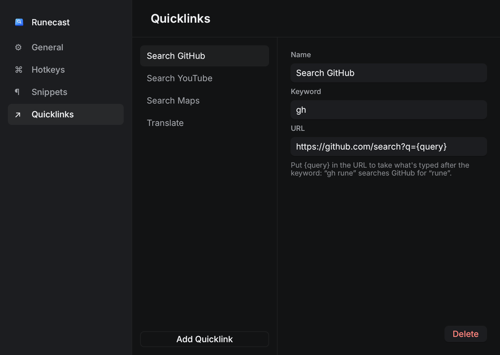

# Runecast

A Raycast-style launcher for macOS (and Linux), built with [Rune](https://github.com/anomalyco/rune), Anomaly's native GPU-rendered Rust UI framework.

Press **⌥Space** (Alt+Space on Linux) from anywhere, type a few letters, hit **↩**.


## What it does

- **Fuzzy app search with real icons.** Finds `.app` bundles in `/Applications`, `/System/Applications` and `~/Applications` on macOS (drawn with their Finder icons), and `.desktop` entries on Linux (with their theme icons). Word starts and prefixes rank first, so `vsc` finds Visual Studio Code. Apps are rescanned each time the panel opens.
- **Smarter ranking.** Apps and commands you run often and recently float to the top, and an empty panel lists them first. Use counts fade by half each week and live in `usage.json`.
- **File search.** Type two or more letters and the best file matches appear above the web search row, from Spotlight on macOS. The Search Files command lists them all; ↩ opens a file, ⌘↩ shows it in Finder.
- **Menu bar icon.** Open Runecast, Clipboard History, Search Files, Settings and Quit (a tray icon on Linux).
- **Clipboard history.** **⌃⌥V**, or the Clipboard History command, lists the last 200 texts you copied, newest first, with a preview. Type to filter; ↩ pastes into the app you were in.
- **Window management** (macOS). Halves, thirds, two thirds, Maximize and Center for the front window, on the screen it's on. Search for them, or use **⌃⌥←**, **⌃⌥→**, **⌃⌥↩** and **⌃⌥C**.
- **Snippets.** Saved text you search by name; ↩ pastes it.
- **Quicklinks.** Saved URLs. A URL with `{query}` takes an argument after its keyword: `gh rune` searches GitHub for "rune". Picking one with nothing typed fills in its keyword for you.
- **Inline calculator.** Type `(1200+340)*1.12` and the answer is the first row; ↩ copies it.
- **System commands.** Lock Screen, Sleep, Empty Trash, Toggle Dark Mode, Open Downloads.
- **Web search fallback.** The last row always searches Google for what you typed.
- **Settings window.** ⌘, in the panel (Ctrl+, on Linux), or the Runecast Settings command. Record any hotkey again, pick a search engine and appearance, turn clipboard history on or off, launch at login, and edit snippets and quicklinks.
- **Keyboard first.** ↑/↓ to move, ↩ to run, esc clears the query, then goes back or closes.

| Clipboard history | Window management |
|---|---|
|  |  |
| **Quicklinks** | **Snippets** |
|  |  |
| **File search** | |
|  | |
| **Calculator** | **Commands** |
|  |  |

## Settings

| General | Hotkeys |
|---|---|
|  |  |
| **Snippets** | **Quicklinks** |
|  |  |

- **General:** appearance (system, light or dark), search engine (Google, DuckDuckGo, Bing, Kagi, Perplexity), launch at login, clipboard history on or off, history size, and Clear History.
- **Hotkeys:** click a shortcut and press a new one; it's rebound immediately, and the old one keeps working if the new one is taken. Backspace turns a hotkey off. Every window layout can have one, not just the four with defaults.
- **Snippets and Quicklinks:** add, rename, edit and delete. Changes save as you type.

Everything is saved in `config.json`, which the first run writes with defaults:

- macOS: `~/Library/Application Support/Runecast/config.json`
- Linux: `~/.config/runecast/config.json`

Hand edits work too and apply the next time the panel opens; "Open config.json" in Settings opens it.

```json
{
  "general": { "appearance": "system", "search_engine": "DuckDuckGo", "clipboard_history": true, "clipboard_size": 200 },
  "hotkeys": { "launcher": "alt+space", "clipboard": "ctrl+alt+v", "window.left-half": "ctrl+alt+left" },
  "snippets": [
    { "name": "Email Signature", "text": "Best,\nDino" }
  ],
  "quicklinks": [
    { "name": "Search GitHub", "keyword": "gh", "url": "https://github.com/search?q={query}" },
    { "name": "Runecast Repo", "url": "https://github.com/dinogomez/runecast" }
  ]
}
```

Clipboard history is saved beside it in `clipboard.json`, readable only by you. It records every text you copy, passwords included, so clear the file if that matters to you.

## Download

Get the latest `.dmg` (macOS) or `.tar.gz` (Linux) from [Releases](https://github.com/dinogomez/runecast/releases). The release notes say how to install it, including how to open an app macOS can't verify yet.

## Run from source

Requires Rust (the toolchain is pinned in `rust-toolchain.toml`).

```sh
cargo run --release
```

Runecast starts in the background with no Dock icon. Press ⌥Space to open it.

On macOS, give Runecast (or the terminal you run it from) **Accessibility** permission in System Settings → Privacy & Security. Pasting from clipboard history and snippets, and moving windows, need it.

On Linux, install `libxkbcommon-dev libwayland-dev` first (see Rune's README). Pasting uses `xdotool` or `wtype` if one is installed; otherwise ↩ only copies.

## Headless screenshots

Rune apps can render without a window, which is how the screenshots above were made:

```sh
target/release/runecast --list-scenes
target/release/runecast --snap docs/clipboard.png --scene clipboard --scale 2 --theme dark
target/release/runecast --snap icons.png --scene installed     # this machine's apps and icons
target/release/runecast --window settings --snap docs/settings-hotkeys.png --scene hotkeys --scale 2 --theme dark
target/release/runecast --tree tree.json --scene calc           # dump the element tree
```

## Layout

- `src/main.rs`: the launcher window and view
- `src/settings.rs`: the Settings window
- `src/hotkeys.rs`: global hotkeys and their registration
- `src/catalog.rs`: apps, commands, snippets, quicklinks, web search and how each runs
- `src/clipboard.rs`: clipboard watcher and history
- `src/wm.rs`: window layouts
- `src/files.rs`: file search
- `src/usage.rs`: usage-based ranking
- `src/menubar.rs`: the menu bar icon
- `src/config.rs`: `config.json`
- `src/login.rs`: launch at login
- `src/fuzzy.rs`: fuzzy ranking
- `src/calc.rs`: the calculator

## Roadmap

- Snippet keywords that expand as you type in any app
- Image entries in clipboard history
- Extensions

Rune is pre-release, so Runecast pins a commit of Rune's `dev` branch.

MIT
