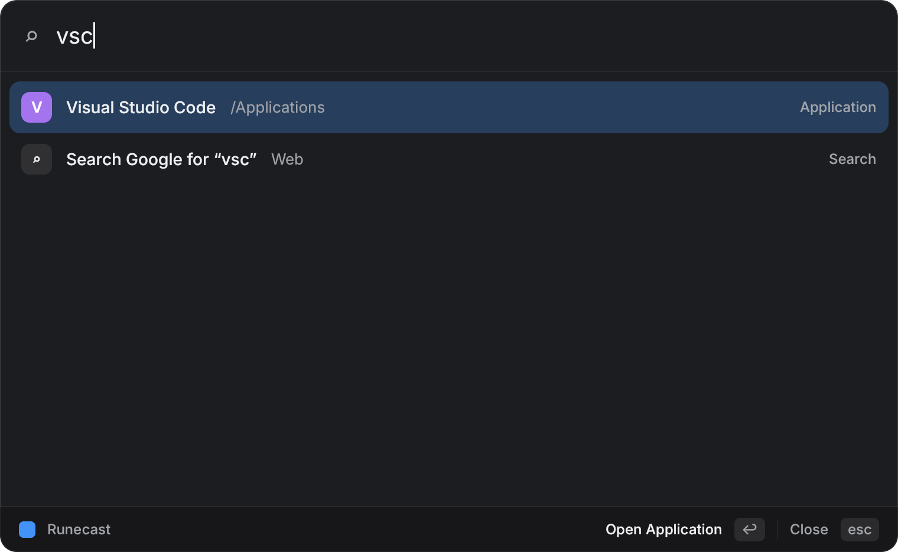
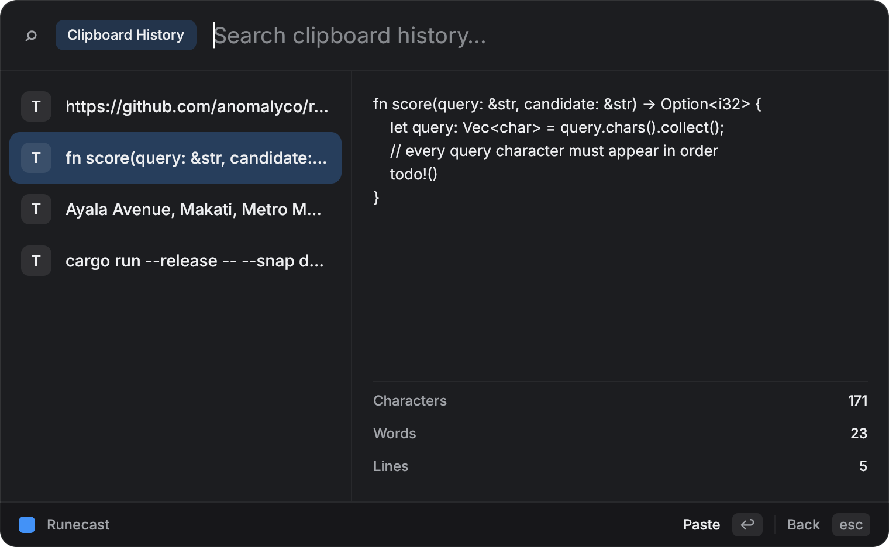
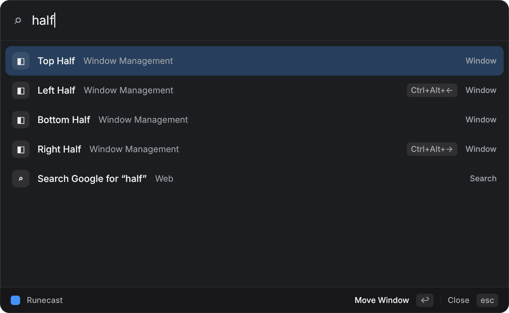
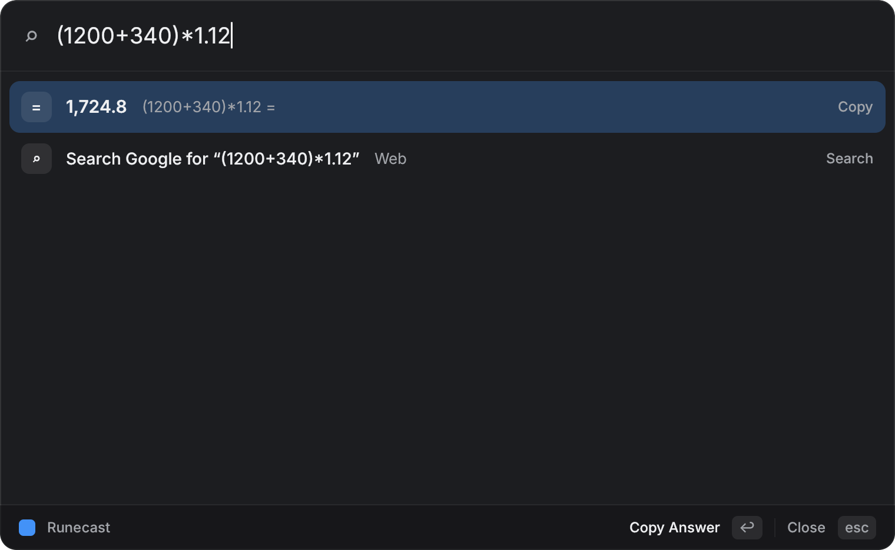
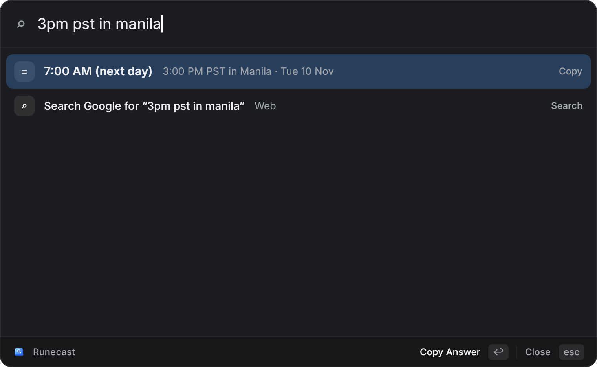
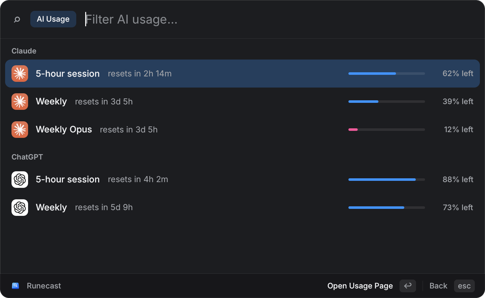

  

<h1 align="center">Runecast</h1>

  A fast, keyboard-first launcher for macOS and Linux, inspired by <a href="https://www.raycast.com">Raycast</a>. 
  Built in Rust with <a href="https://github.com/anomalyco/rune">Rune</a>.

  
  
  
  
  

  Press <kbd>⌥ Option</kbd> + <kbd>Space</kbd> (<kbd>Alt</kbd> + <kbd>Space</kbd> on Linux), type a few letters, hit <kbd>↩ Return</kbd>.

## Features

| | Feature | Try |
|---|---|---|
| 🚀 | Fuzzy app search, ranked by what you use most | `vsc` |
| 📄 | File search | `report` |
| 📋 | Clipboard history | <kbd>⌃ Control</kbd> + <kbd>⌥ Option</kbd> + <kbd>V</kbd> |
| 🪟 | Window management (macOS) | `half`, <kbd>⌃ Control</kbd> + <kbd>⌥ Option</kbd> + <kbd>←</kbd> |
| ✂️ | Snippets and quicklinks | `sig`, `gh rune` |
| 🧮 | Calculator and conversions | `(1200+340)*1.12`, `100 usd to php`, `3pm pst in manila` |
| ⚙️ | System commands | `dark`, `volume`, `quit Safari` |
| 🏷️ | Aliases for any app or command | `vs` |
| 📊 | Claude and ChatGPT plan usage left, from the Claude Code and Codex sign-in | `AI Usage` |
|  | Menu bar icon (tray on Linux) | |

Anything else falls back to a web search.

| Clipboard history | Window management |
|---|---|
|  |  |
| **Calculator** | **Time zones** |
|  |  |
| **AI usage** | |
|  | |

## Install

Download the `.dmg` (macOS) or `.tar.gz` (Linux) from [Releases](https://github.com/dinogomez/runecast/releases). The release notes cover first-launch steps.

On macOS, grant Runecast **Accessibility** permission (System Settings → Privacy & Security) so it can paste and move windows.

## Shortcuts

| Shortcut | Action |
|---|---|
| <kbd>⌥ Option</kbd> + <kbd>Space</kbd> | Open Runecast |
| <kbd>⌃ Control</kbd> + <kbd>⌥ Option</kbd> + <kbd>V</kbd> | Clipboard history |
| <kbd>⌃ Control</kbd> + <kbd>⌥ Option</kbd> + <kbd>←</kbd> | Move window to the left half |
| <kbd>⌃ Control</kbd> + <kbd>⌥ Option</kbd> + <kbd>→</kbd> | Move window to the right half |
| <kbd>⌃ Control</kbd> + <kbd>⌥ Option</kbd> + <kbd>↩ Return</kbd> | Maximize window |
| <kbd>⌃ Control</kbd> + <kbd>⌥ Option</kbd> + <kbd>C</kbd> | Center window |
| <kbd>⌘ Cmd</kbd> + <kbd>,</kbd> | Settings |
| <kbd>⎋ Esc</kbd> | Clear, go back, or close |

Rebind any of these in Settings. On Linux, use <kbd>Ctrl</kbd> in place of <kbd>⌘ Cmd</kbd> and <kbd>Alt</kbd> in place of <kbd>⌥ Option</kbd>.

## Configuration

Settings (search engine, appearance, hotkeys, snippets, quicklinks, aliases) are saved to `config.json`. You can also edit the file by hand:

- macOS: `~/Library/Application Support/Runecast/`
- Linux: `~/.config/runecast/`

Clipboard history is stored in the same folder and includes everything you copy. You can turn it off in Settings.

AI Usage reads the sign-in that Claude Code (`~/.claude`, or the Keychain on macOS) and Codex (`~/.codex/auth.json`) already saved, so sign in to those CLIs first. The usage endpoints it calls aren't documented and may change.

## Check out Raycast

**Give [Raycast](https://www.raycast.com) a look first!** Runecast is a small open-source project inspired by it, and isn't affiliated with Raycast. If you're on macOS and want a polished launcher with a large extension store.

## Contributing

See [CONTRIBUTING.md](CONTRIBUTING.md) for building from source, tests, screenshots and the code layout.

## License

MIT
